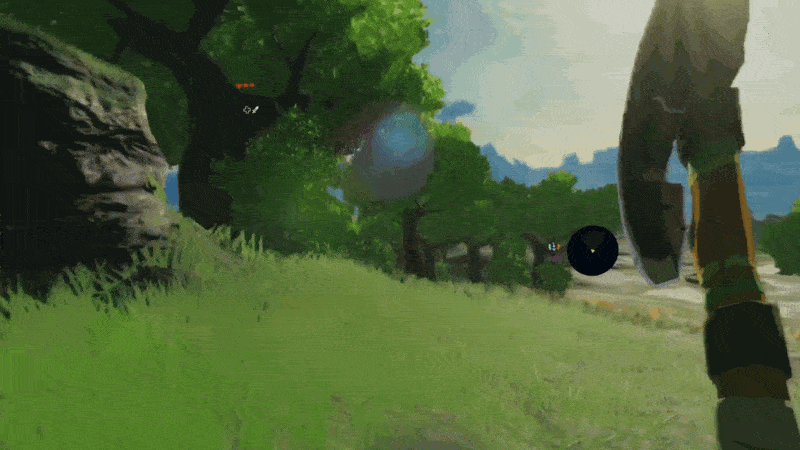
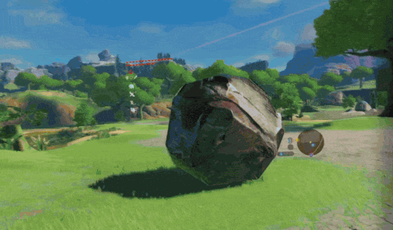
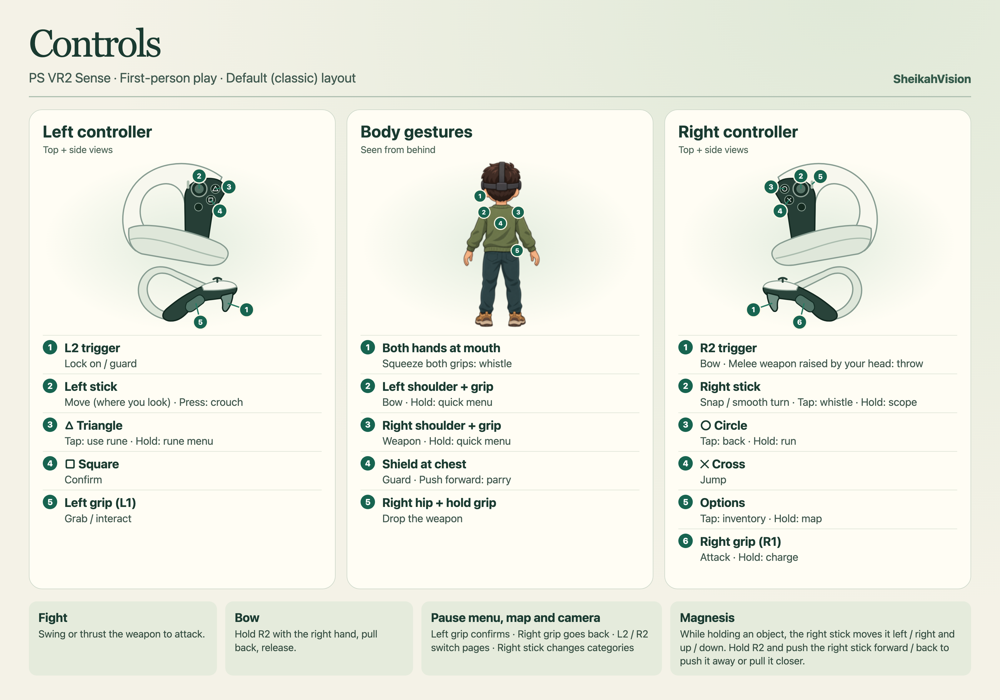
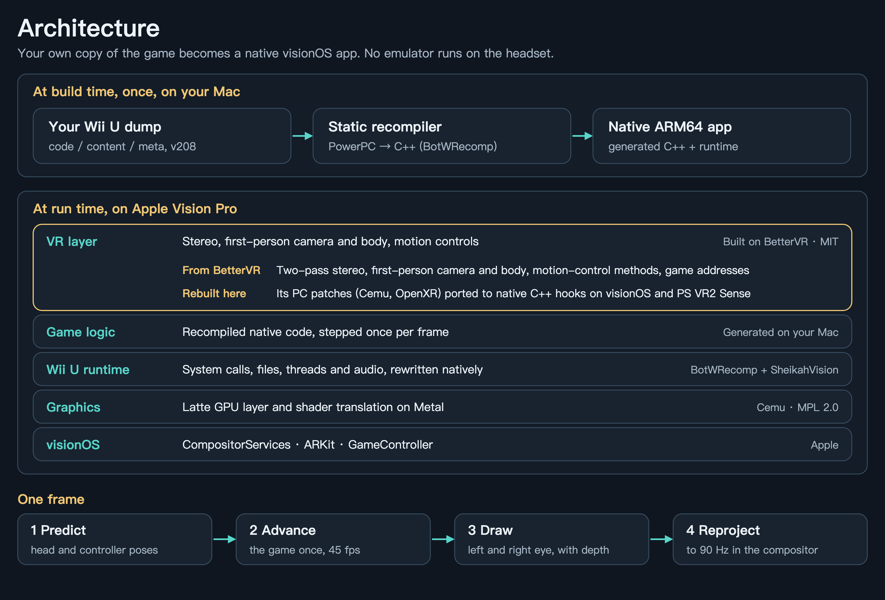

# SheikahVision

**Breath of the Wild in first-person VR, running natively on Apple Vision Pro — no PC, no streaming.**

Built on **[BetterVR](https://github.com/Crementif/BotW-BetterVR)** by Crementif and **[BotWRecomp](https://github.com/IshaanKalra2103/BotWRecomp)** by Ishaan Kalra. 
BetterVR's years of work on Breath of the Wild in VR are what made this possible.

[English](README.md) · [简体中文](README.zh-CN.md)

 
<strong>Axe fight with a Bokoblin</strong> · swing the controller to swing the axe.

Captured on an Apple Vision Pro.

> [!IMPORTANT]
> SheikahVision is an **unofficial fan project**. It is not affiliated with, endorsed by or sponsored by Nintendo.
> This repository and its releases contain **no game code, no game assets, no keys and no prebuilt game app**, and none will ever be provided. The only save included is an optional experience save from the project's author (a completed game, so you can try everything without starting over); it stays off unless you turn it on.
> To play, you need your own legally purchased Wii U copy of *The Legend of Zelda: Breath of the Wild* (update v208), dumped by yourself. The Mac installer builds the app on your own Mac from those files.

## What it is

SheikahVision turns Breath of the Wild into a first-person VR game on Apple Vision Pro. The game logic runs as native ARM64 code on the headset itself:

- **No emulator at run time.** The Wii U executable is statically recompiled into C++ on your Mac at build time ([BotWRecomp](https://github.com/IshaanKalra2103/BotWRecomp)), then compiled into a visionOS app together with a rewritten Wii U system runtime.
- **Graphics** go through Cemu's Latte renderer on Metal.
- **The VR layer is built on [BetterVR](https://github.com/Crementif/BotW-BetterVR)** by Crementif, the PC VR mod for the same game: its stereo rendering, first-person camera and body, motion controls, research and game addresses, with parts of its patches ported to C++. SheikahVision adapts them to visionOS (CompositorServices, ARKit, PS VR2 Sense controllers).

## Features

- Native stereo rendering for each eye, reprojected to 90 Hz by the headset (game at 45 fps).
- First-person view with Link's own arms following your hands.
- Motion controls: swing and stab with the sword, guard with the shield, draw and aim the bow with both hands, throw weapons and bombs.
- Body slots (BetterVR style): reach over a shoulder to draw weapons or open quick menus, reach to your waist to drop items, whistle with both hands at your mouth.
- PS VR2 Sense controllers with a classic gamepad layout (see [Controls](#controls)).
- Snap or smooth turning, adjustable view height, fully immersive view.
- A visionOS launcher: import your game files on the headset, pick quality (Standard / Smooth), manage saves.
- An optional experience save (a switch on the home page, or Settings › Saves): the author's completed game in a save folder of its own, to try every area and rune right away; your own saves are not touched.

## More gameplay

 
<strong>Magnesis</strong> · lift a boulder and move it where you look.

More gameplay videos on the website: **[sheikahvision.com](https://sheikahvision.com/#demo)**.

## Status

**Beta — playable, not yet polished.** Most of the game works from start to finish in first person, but there are open problems. The Mac installer takes care of building and installing; it still needs Xcode on your Mac. See the [open issues](../../issues).

> **A one-person, spare-time project.** SheikahVision was built by one person over a few weeks of spare time. The whole game can be played through, but there are certainly bugs I have not found or had time to fix, and I cannot work on it full-time. That is why it is open source: if something bothers you, an issue with a log or, even better, a pull request is the fastest way to get it fixed.

| | |
|---|---|
| Tested hardware | Apple Vision Pro (M5), visionOS 27 |
| Untested | Apple Vision Pro (M2) — help wanted |
| Picture | about 1540×1345 per eye, 45 fps, 90 Hz reprojection |
| Game versions | Wii U v208 — Japan and USA (tested), Europe (supported, not tested yet) |
| Controllers | PlayStation VR2 Sense |

The main open issues right now: picture sharpness (the headset needs more pixels per degree than the GPU budget allows today), busy areas such as Korok Forest and towns dipping below 45 fps, and a few motion-control details. Contributions are very welcome.

## Requirements

- An Apple Silicon Mac with Xcode 26 or newer (free from the [Mac App Store](https://apps.apple.com/app/xcode/id497799835)) and its visionOS component (the visionOS SDK, needed to build for the headset; it also downloads the simulator, which is not used), and at least 25 GB of free disk space for the build (about 40 GB is comfortable), on top of Xcode itself
- The build tools cmake, ninja and uv (`brew install cmake ninja uv` with [Homebrew](https://brew.sh)); the installer's first step tells you if any are missing
- An Apple account signed in to Xcode (a free account works; the app then expires after 7 days and is renewed from the installer in one click; a paid developer account lasts a year)
- Apple Vision Pro in Developer Mode, paired with your Mac (the installer walks you through it)
- A pair of PlayStation VR2 Sense controllers paired with the headset
- Your own Wii U copy of Breath of the Wild with update v208, dumped yourself as decrypted files and combined into one game folder (`code`, `content`, `meta`). Disc images (WUD / WUX) are not used. See [step 2 of the build guide](docs/BUILDING.md#2-prepare-the-game-files) for the format and how the dumps fit together

No Vision Pro? You can still help: the game also runs in a VR mode on the Mac for development and testing.

## Getting started

### Option 1: the Mac installer (recommended)

1. **Prepare your Mac:** install Xcode from the [Mac App Store](https://apps.apple.com/app/xcode/id497799835) (a large download), open it once, download **visionOS** under Xcode › Settings › Components (it holds the visionOS SDK needed to build for the headset; the few GB of simulator that come with it are not used, but cannot be skipped) and sign in to your Apple account under Settings › Accounts. Then install the build tools: `brew install cmake ninja uv`.
2. **Download** `SheikahVision-Installer-<version>.zip` from [Releases](https://github.com/zlinoliver/BotW-SheikahVision/releases/latest), unzip it and move **SheikahVision Installer** to Applications.
3. **Open it once** from System Settings › Privacy & Security › **Open Anyway**. The installer is not notarized, so macOS asks this the first time.
4. **Follow its five steps:** Mac check, Apple account, game files, Vision Pro, Install. It builds the app on your Mac from your own game files, signs it with your own account, installs it on the headset and transfers the game, which the app then imports by itself. Wear the headset from the install step on.
5. **Play.** First launch compiles shaders and takes a little longer.

The [installer guide](docs/INSTALLER.md) covers each step, pairing the headset, renewing a free account and updating. When a new version comes out, download the new installer and choose **Install new version**: the app is rebuilt, and your game and saves on the headset are kept. What changed in each version is in the [changelog](docs/CHANGELOG.md) and on the Releases page.

### Option 2: build from source

Build, sign and install it yourself with the command-line tools — see [docs/BUILDING.md](docs/BUILDING.md).

For contributors without a headset: [step 4 of the build guide](docs/BUILDING.md#4-optional-build-and-run-on-the-mac) runs the game on a Mac, including the VR mode.

## Controls

Controls as text

| Button | Action |
|---|---|
| Left stick | Move (follows where you look) · press: crouch |
| Right stick | Snap / smooth turn · tap: whistle · hold: scope |
| Left grip | Grab / interact (A) |
| Right grip | Attack (Y), hold to charge |
| Left trigger (L2) | Lock on / guard (ZL) |
| Right trigger (R2) | Bow (ZR) · melee weapon raised beside your head: throw |
| Square | Confirm (A) |
| Triangle | Use rune · hold: rune menu |
| Cross | Jump |
| Circle | Back / cancel · hold: run |
| Options | Inventory · hold: map |

Gestures: right hand over the right shoulder (grip) — weapon / quick menu; left hand over the left shoulder — bow / quick menu; right hand at the waist (hold grip) — drop; both hands at the mouth with both grips — whistle; raise the shield to chest height — guard, push it forward — parry.

In the pause menu, the map and the Camera rune: left grip confirms (captures), right grip goes back, L2 / R2 switch pages, the right stick changes categories.

Magnesis, while holding an object: the right stick moves it left / right and up / down; hold R2 or the right grip and push the right stick forward / back to push it away or pull it closer.

## Architecture

A detailed architecture write-up is planned.

## Contributing

Bug reports, fixes, research and documentation are all welcome — see [CONTRIBUTING.md](.github/CONTRIBUTING.md). Good places to start are the issues labelled **good first issue** and **help wanted**.

Questions and ideas go to [GitHub Discussions](../../discussions). This is a spare-time project, so replies may take a few days.

**Never post game files, keys, dumps, IPA files or links to them** in issues, pull requests or discussions. They will be removed.

## Credits

SheikahVision stands on the shoulders of:

- **[BetterVR](https://github.com/Crementif/BotW-BetterVR)** by Crementif and contributors (MIT) — the PC VR mod whose methods, research and game addresses the VR layer follows. Thank you, this project would not exist without it.
- **[BotWRecomp](https://github.com/IshaanKalra2103/BotWRecomp)** by Ishaan Kalra (MIT) — the static recompilation of Breath of the Wild this project is built on.
- **[Cemu](https://github.com/cemu-project/Cemu)** (MPL 2.0) — the Latte graphics layer.
- **[Glovebox](https://github.com/glovebox-vr/glovebox)** (MIT) — the Mac installer for Half-Life: Alyx on Vision Pro, which the SheikahVision Mac installer is modelled on.
- SDL3, fmt, zstd, Dear ImGui and the other libraries listed in [THIRD_PARTY_NOTICES.md](LICENSES/THIRD_PARTY_NOTICES.md).

## License

SheikahVision's own code is released under the [MIT License](LICENSE). Third-party components keep their own licenses (Cemu's code under MPL 2.0); see [THIRD_PARTY_NOTICES.md](LICENSES/THIRD_PARTY_NOTICES.md).

*The Legend of Zelda* and *Breath of the Wild* are trademarks of Nintendo. This project is not affiliated with Nintendo.
