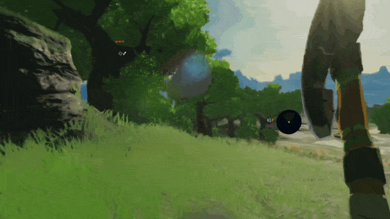
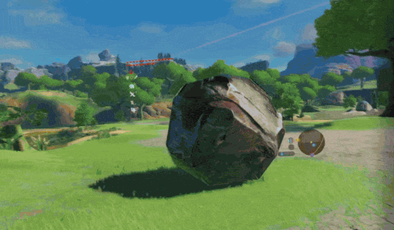
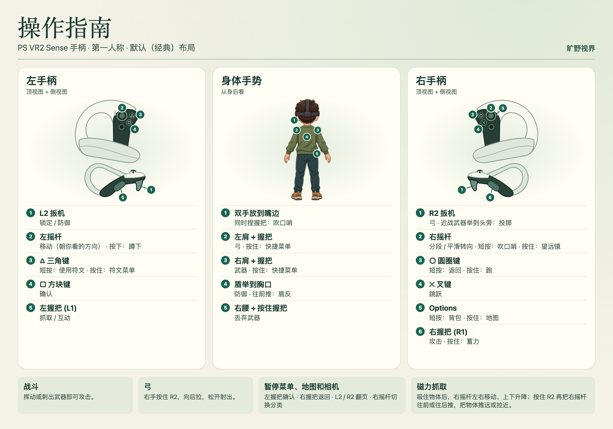
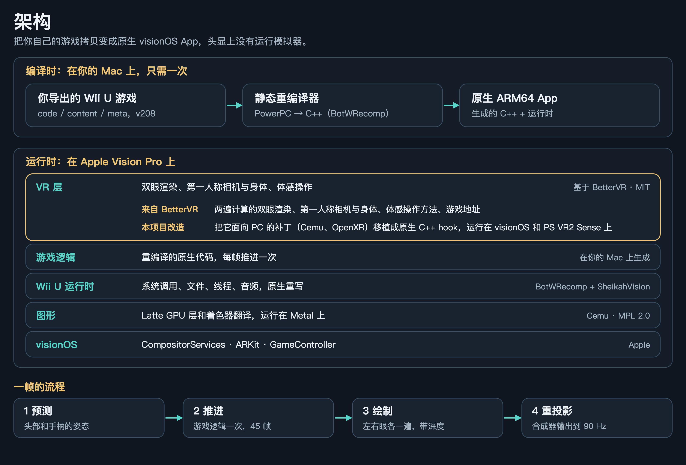

# 旷野视界（SheikahVision）

**在 Apple Vision Pro 上本地运行的《塞尔达传说 旷野之息》第一人称 VR，不需要 PC，不需要串流。**

[English](README.md) · [简体中文](README.zh-CN.md)

 
<strong>用斧头和波克布林战斗</strong> · 挥动手柄就是挥斧。

在 Apple Vision Pro 上实机录制。

> [!IMPORTANT]
> 旷野视界是**非官方的粉丝项目**，与任天堂无关，未经任天堂认可或赞助。
> 本仓库及其发布页**不包含任何游戏代码、游戏资源、密钥或编译好的游戏 App**，以后也不会提供。唯一附带的存档是项目作者提供的可选体验存档（已通关，不用从头玩就能体验所有内容），默认关闭，需要你自己打开。
> 游玩需要你自己购买的 Wii U 正版《塞尔达传说 旷野之息》（更新 v208），由你自己导出；Mac 安装器会用这些文件在你自己的 Mac 上编译 App。

## 这是什么

旷野视界把旷野之息变成 Apple Vision Pro 上的第一人称 VR 游戏，游戏逻辑以原生 ARM64 代码直接在头显上运行：

- **运行时不用模拟器。** 编译时在你的 Mac 上把 Wii U 可执行文件静态重编译成 C++（[BotWRecomp](https://github.com/IshaanKalra2103/BotWRecomp)），再和重写的 Wii U 系统运行时一起编译成 visionOS App。
- **图形**走 Cemu 的 Latte 渲染器，后端是 Metal。
- **VR 改写层**（双眼渲染、第一人称相机与身体、体感操作）沿用 PC 版 VR 模组 [BetterVR](https://github.com/Crementif/BotW-BetterVR) 的做法，适配到 visionOS（CompositorServices、ARKit、PS VR2 Sense 手柄）。

## 功能

- 双眼原生渲染，游戏 45 帧，头显重投影到 90 Hz。
- 第一人称视角，林克的手臂跟随你的双手。
- 体感操作：挥剑、刺击、举盾防御、双手拉弓瞄准、投掷武器和炸弹。
- 身体槽位（BetterVR 式）：手伸到肩后取武器或打开快捷菜单，伸到腰部丢弃物品，双手放到嘴边吹口哨。
- PS VR2 Sense 手柄，经典手柄布局（见[操作](#操作)）。
- 分段 / 平滑转向、可调视角高度、全沉浸画面。
- visionOS 启动器：在头显上导入游戏文件、选择画质（标准 / 流畅）、管理存档。
- 可选的体验存档（首页的开关，或 设置 › 存档）：作者自己打通的存档，放在单独的文件夹里，打开就能马上体验各个地区和符文；你自己的存档不受影响。

## 更多实机画面

 
<strong>磁力抓取</strong> · 举起巨石，往你看的方向移动。

更多演示视频见网站：**[sheikahvision.com](https://sheikahvision.com/zh-cn/#demo)**。

## 当前状态

**Beta：可以玩，还不够完善。** 第一人称下大部分内容可以从头玩到尾，但还有未解决的问题。编译和安装由 Mac 安装器完成，但 Mac 上仍需要安装 Xcode。见[问题列表](../../issues)。

> **一个人业余时间做的项目。** 旷野视界是我一个人用几周的零碎时间做出来的。整个游戏可以从头玩到尾，但肯定还有不少我没发现、或者没时间修的 bug，我也没法全职投入。这正是开源的原因：遇到问题时，附上日志提一个 Issue，或者更好的是直接提交 PR，是让它最快被修好的方式。

| | |
|---|---|
| 已测试设备 | Apple Vision Pro（M5），visionOS 27 |
| 未测试 | Apple Vision Pro（M2），欢迎帮忙 |
| 画面 | 每只眼约 1540×1345，45 帧，90 Hz 重投影 |
| 游戏版本 | Wii U v208：日版和美版（已测试）、欧版（已支持，尚未测试） |
| 手柄 | PlayStation VR2 Sense |

目前主要的未解决问题：画面清晰度（头显需要的每度像素数超出了目前的 GPU 预算）、克洛格森林和城镇等复杂场景会低于 45 帧、几处体感细节。非常欢迎参与。

## 需要准备

- Apple Silicon Mac，安装 Xcode 26 或更新版本（在 [Mac App Store](https://apps.apple.com/app/xcode/id497799835) 免费下载）及其 visionOS 组件（里面的 visionOS SDK 是给头显编译必需的；它会顺带下载模拟器，用不到）；除了 Xcode 本身，编译还需要至少 25 GB 可用磁盘空间（约 40 GB 比较宽裕）
- 编译工具 cmake、ninja、uv（用 [Homebrew](https://brew.sh) 安装：`brew install cmake ninja uv`）；缺哪个，安装器第一步会告诉你
- 在 Xcode 里登录的 Apple 账号（免费账号即可，App 7 天后过期，在安装器里一键续签；付费开发者账号一年有效）
- 开启开发者模式并与 Mac 配对的 Apple Vision Pro（安装器会一步步带你完成）
- 一对已和头显配对的 PlayStation VR2 Sense 手柄
- 你自己的 Wii U 旷野之息正版拷贝及 v208 更新，由你自己导出为已解密的文件并合并成一个游戏文件夹（`code`、`content`、`meta`），不使用光盘镜像（WUD / WUX）。格式和合并方法见[编译指南第 2 步](docs/BUILDING.zh-CN.md#2-准备游戏文件)

没有 Vision Pro？也可以参与：游戏在 Mac 上也能以 VR 模式运行，用于开发和测试。

## 开始使用

### 方式一：Mac 安装器（推荐）

1. **准备 Mac：** 从 [Mac App Store](https://apps.apple.com/app/xcode/id497799835) 安装 Xcode（下载量很大），打开一次，在 Xcode › Settings › Components 里下载 **visionOS**（里面的 visionOS SDK 是给头显编译必需的；会顺带下载几 GB 的模拟器，用不到，但没法单独跳过），在 Settings › Accounts 登录 Apple 账号；再安装编译工具：`brew install cmake ninja uv`。
2. **下载：** 从 [Releases](https://github.com/zlinoliver/BotW-SheikahVision/releases/latest) 下载 `SheikahVision-Installer-<版本>.zip`，解压后把 **SheikahVision Installer** 拖到「应用程序」。
3. **第一次打开：** 到 系统设置 › 隐私与安全性，点 **仍要打开**。安装器没有经过公证，macOS 第一次会这样询问。
4. **按五步走：** Mac 检查、Apple 账号、游戏文件、Vision Pro、安装。安装器会在你的 Mac 上用你自己的游戏文件编译 App，用你自己的账号签名，装到头显，再把游戏传过去，头显上的 App 会自动导入。从安装那一步开始要戴着头显。
5. **开玩：** 第一次启动要编译着色器，会稍慢。

每一步的说明、头显配对、免费账号续签和更新方法见[安装器使用指南](docs/INSTALLER.zh-CN.md)。有新版本时，下载新的安装器并选择 **安装新版本**：App 会重新编译，头显上的游戏和存档都会保留。每个版本更新了什么，见[更新记录](docs/CHANGELOG.md)和 Releases 页面。

### 方式二：从源码编译

用命令行工具自己编译、签名和安装，见 [docs/BUILDING.zh-CN.md](docs/BUILDING.zh-CN.md)。

没有头显的贡献者：[编译指南第 4 步](docs/BUILDING.zh-CN.md#4可选在-mac-上编译运行)说明如何在 Mac 上运行游戏，包括 VR 模式。

## 操作

文字版操作说明

| 按键 | 功能 |
|---|---|
| 左摇杆 | 移动（朝你看的方向）· 按下：蹲下 |
| 右摇杆 | 分段 / 平滑转向 · 短按：吹口哨 · 按住：望远镜 |
| 左握把 | 抓取 / 互动（A） |
| 右握把 | 攻击（Y），按住蓄力 |
| 左扳机（L2） | 锁定 / 防御（ZL） |
| 右扳机（R2） | 弓（ZR）· 近战武器举到头旁时：投掷 |
| □ | 确认（A） |
| ▲ | 使用符文 · 按住：符文菜单 |
| ✕ | 跳跃 |
| ○ | 返回 / 取消 · 按住：跑 |
| Options | 背包 · 按住：地图 |

手势：右手到右肩捏握把，拿武器 / 快捷菜单；左手到左肩，拿弓 / 快捷菜单；右手到腰部按住握把，丢弃；双手放到嘴边同时捏握把，吹口哨；把盾举到胸口高度，防御，往前推，盾反。

暂停菜单、地图和相机符文里：左握把确认（拍照），右握把返回，L2 / R2 翻页，右摇杆切换分类。

磁力抓取，吸住物体后：右摇杆左右移动、上下升降；按住 R2 或右握把，再把右摇杆往前或往后推，把物体推远或拉近。

## 架构

更详细的架构说明后续补充。

## 参与贡献

欢迎提交问题、修复、研究和文档，见 [CONTRIBUTING.md](.github/CONTRIBUTING.md)。可以从标签为 **good first issue** 和 **help wanted** 的问题开始。

提问和想法请发到 [GitHub Discussions](../../discussions)。这是业余项目，回复可能需要几天。

**请勿在问题、PR 或讨论中发布游戏文件、密钥、导出内容、IPA 或相关链接**，发现即删除。

## 致谢

旷野视界建立在以下项目之上：

- **[BetterVR](https://github.com/Crementif/BotW-BetterVR)**，作者 Crementif 及贡献者（MIT）：VR 改写层沿用了它的方法、研究和游戏地址。谢谢，没有它就没有这个项目。
- **[BotWRecomp](https://github.com/IshaanKalra2103/BotWRecomp)**，作者 Ishaan Kalra（MIT）：本项目所基于的旷野之息静态重编译。
- **[Cemu](https://github.com/cemu-project/Cemu)**（MPL 2.0）：Latte 图形层。
- **[Glovebox](https://github.com/glovebox-vr/glovebox)**（MIT）：在 Vision Pro 上玩《半衰期：爱莉克斯》的 Mac 安装器，旷野视界的 Mac 安装器参照它制作。
- SDL3、fmt、zstd、Dear ImGui 等，完整列表见 [THIRD_PARTY_NOTICES.md](LICENSES/THIRD_PARTY_NOTICES.md)。

## 许可证

旷野视界自有代码以 [MIT 许可证](LICENSE) 发布。第三方组件保留各自的许可证（Cemu 代码为 MPL 2.0），见 [THIRD_PARTY_NOTICES.md](LICENSES/THIRD_PARTY_NOTICES.md)。

《塞尔达传说》《旷野之息》是任天堂的商标。本项目与任天堂无关。
